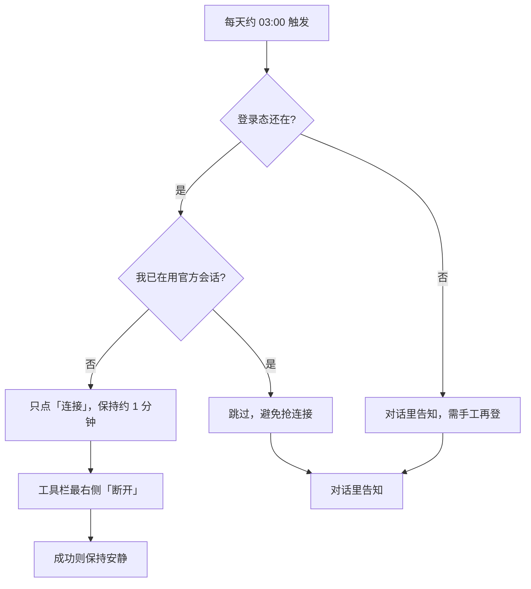
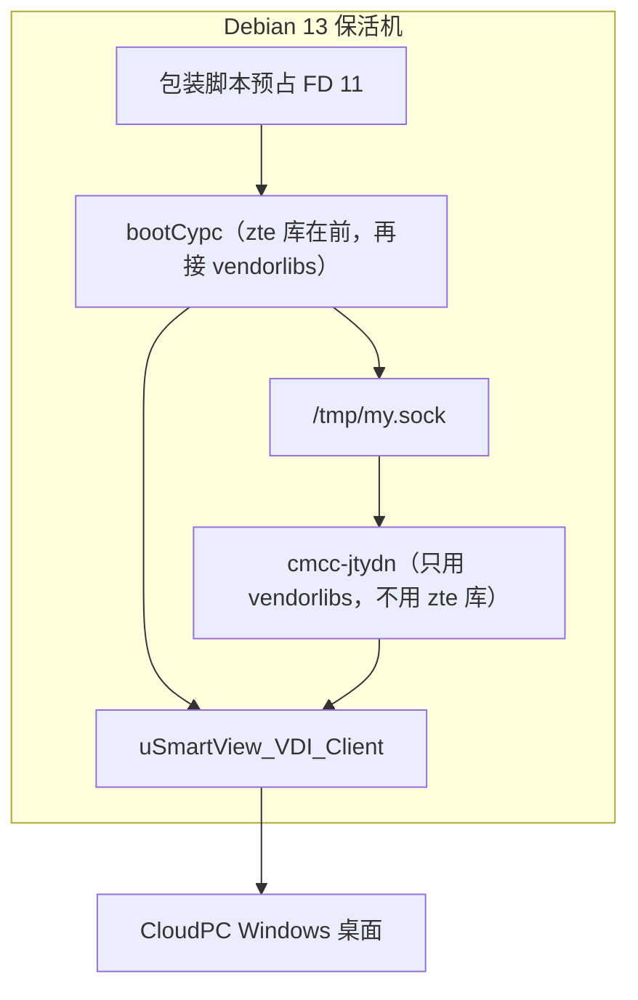

移动云电脑在官方客户端断开后，会按「断连定时策略」倒计时关机。用户协议 4.2：默认 30 分钟，最长 24 小时（江苏套餐最长 8 小时）。SSH、RDP、向日葵和机器内部的定时任务都不算官方会话，挡不住这次关机。

<!--more-->

做法就一条：把断连策略调到 24 小时，在常驻的 Debian 13 机器（Grok Bot 的 Linux 电脑）上，用官方统信（UOS）客户端每天约 03:00 连一次、保持约 1 分钟、再用官方「断开」。这样 24 小时内至少有一次官方会话，倒计时会重新起算。

2026-11-23 已验证：能连上、能官方断开、断开后马上再连不再报 12220002。当天已排上例行任务「CloudPC 每日保活」。到写这篇时，凌晨自动保活还没真正跑过，下次是 11 月 24 日约 03:00（上海时间）。

## 整体路径





## 关键取舍

| 项目 | 说明 |
| --- | --- |
| 客户端 | 官方只有 Windows / macOS / 麒麟 ARM64 / 统信 UOS AMD64 / 手机，没有通用 Linux 或命令行。「连接」「断开」只能走图形界面。Debian 13 是 Debian 系，所以用 UOS 包 `CMCC-JTYDN-UOSx86-2.23.1.deb`，装在 `/opt/chuanyun-vdi-client`，主程序 `cmcc-jtydn`。下载见 [移动云电脑客户端下载页](https://soho.komect.com/clientDownload)。 |
| 登录 | 登录窗口是 Electron 原生界面，要在图形界面手工登一次。登录态可保持，之后重启会直接进「我的云电脑」。定时任务不能代填密码。 |
| 会话 | 同一账号同时只能有一个官方远程会话。我正在用时，保活再连会卡住「连接中」，等于抢会话，所以已占用就跳过。 |
| 操作 | 只点「连接」；断开只点工具栏最右侧「断开」。卡片或工具栏上的「重启」会重启云电脑本身，不要点。 |
| 定时 | 原计划 03:00 连、03:01 断，但例行任务两条 cron 至少间隔 5 分钟，所以合成一条：`0 3 * * *`（Asia/Shanghai）。周末也跑。最多提前 15 分钟，不允许晚于 03:00。 |

不要用官方 `launch-app.sh`：它会把 UOS 旧 glibc 2.31 插到库路径最前，和 Debian 13 的 glibc 2.41 冲突。做法是自建 vendorlibs（去掉 `libc`、`libm`、`libmount`、动态链接器），脚本放固定目录，不要放 `/tmp`。

| 进程 | 库路径与启动顺序 |
| --- | --- |
| `bootCypc`（在 `chuanyunAddOn-zte` 里，创建 `/tmp/my.sock`，再拉起 VDI） | `LD_LIBRARY_PATH` 必须是 zte 自带库在前、vendorlibs 在后。先预占 FD 11；设置 `QT_PLUGIN_PATH` 指向 UOS 的 Qt 插件，以及 `LANG` / `LC_ALL=en_US.UTF-8`。等 socket 出现再启主程序。 |
| `cmcc-jtydn`（Electron） | `LD_LIBRARY_PATH` 只能有 vendorlibs，不能带 zte 的 `ccsdk/lib`。zte 是 OpenSSL 3.1.3，混进主进程会污染（系统是 OpenSSL 3.5，客户端链的是 BoringSSL）。已在运行则不再拉第二个实例。 |
| `jsCysdk.js` 补丁 | 官方成功路径往往不回调「已连接 / 已断开」，需按 `bootCypc` 日志补偿。Electron 自己拉起 `bootCypc` 时，也走同一套包装脚本和库路径。 |

预占 FD 11 的包装：

```bash
#!/bin/bash
exec 11<>/dev/null
exec "$@"
```

## 踩坑一览

| # | 现象 | 原因 | 处理 |
| --- | --- | --- | --- |
| 1 | `launch-app.sh` 起不来，报 `MOUNT_2_40`、`GLIBC_2.38` / `2.39` | 旧 glibc 覆盖系统库 | 不用官方脚本，自建 vendorlibs |
| 2 | 缺 `libchuanyun.so`；`bootCypc` 缺 Qt，界面卡在「连接中」，`ENOENT /tmp/my.sock` | 库不在默认路径；`bootCypc` 不继承父进程库路径 | 两套库路径分开；先起 `bootCypc`，等 socket 再起客户端 |
| 3 | 错误 12000001，MQTT 的 TLS 被复位 | Electron 误加了 zte 的 `ccsdk/lib`（OpenSSL 3.1.3）；部分域名还被 Clash Fake-IP 解析 | Electron 只用 vendorlibs。去掉 zte 后 12000001 消失。MQTT 不通仍在，但不是连/断失败的根因 |
| 4 | `uSmartView_VDI_Client` 以状态 127 退出，缺一批旧 soname | VDI 按旧 soname 链接，不能把新库改名冒充。缺过：`libQt5PrintSupport.so.5`、`libpulse-mainloop-glib.so.0`、`libwebp.so.6`、`libaom.so.0`、`libwavpack.so.1`、`libx264.so.155`；还要正确的 `QT_PLUGIN_PATH` | 补匹配的旧版本：官方 Qt 5.12.4，Debian bullseye 的 webp / aom，Ubuntu 20.04 的 `libx264.so.155`，Debian 13 的 pulse / wavpack |
| 5 | GSpice 非法字节序列；环境是 `LC_ALL=en_US.UTF-8`，但 `locale -a` 只有 `C`、`C.utf8`、`POSIX` | locale 名称在环境变量里，归档并未生成 | 用已有 `localedef` 生成，不走 `apt install locales`，以免把 `libc6` 一并升级 |
| 6 | 找不到 `avcodec_set_decode_opt` | vendorlibs 里原版 `libavcodec` 没有该符号，zte 里打过补丁的才有；顺序反了就会加载错 | 只对 `bootCypc` / VDI 把 zte 库放最前。之后在 2026-11-23 约 00:39 第一次连上 Windows 桌面 |
| 7 | 官方断开后主界面仍显示「连接中」，按钮是灰的，约两分多钟才恢复 | `libvdconn` / `bootCypc` 在成功路径上不给 Electron 回调（失败路径反而会回调） | 给 `jsCysdk.js` 按日志补偿：「Start vdi process success」后约 12 秒无回调则补连接成功；「vdi process end!」后约 1.5 秒，优先确认「Clear vmid」或「Success to Disconnect desktop」再补断开。官方回调先到就以官方为准。补丁后大约数秒恢复 |
| 8 | 断开后约半分钟内再连，报 12220002（内部还有 A2100 / `iCode -5`），约 6 分钟才能再连 | `WaitSelect` 把 `accept()` 的返回值直接和 11 比较，而 11 本应表示 `EAGAIN`。新描述符恰好是 11 时会漏登记，却留下约 359999 毫秒的「正在连接」标记 | 启动 `bootCypc` 前执行 `exec 11<>/dev/null`。2026-11-23 上午回归：断开后约 4 秒恢复，约 24 秒后再连成功，没有再出现 12220002。界面自动重试盖不住这 6 分钟窗口，只是辅助 |
| 9 | 一些日志在成功和失败时都会出现 | MQTT 保活失败（相关域名被解析到 Fake-IP，TLS 被复位）、向本地 46666 端口发退出通知失败、GPU / dbus / dri3 / swiftshader 警告 | 排查时不要被这些日志带偏，它们不是连/断失败的根因 |

生成 locale 后仍见过与 `ztencr` 有关的日志。官方安装树、deb 和 asar 里都没有这个文件，没有自行补一个假的。它不是连通成功的必要条件，目前也仍缺失。

## 尚未解决

| 问题 | 说明 |
| --- | --- |
| `ztencr` 仍然缺失 | 有日志，不阻塞连通 |
| 没有 `dmidecode`、`lsb_release`，1 号进程也不是 systemd | 官方附带的一些服务单元跑不起来，目前不阻塞连接和断开 |
| 剪切板相关组件还需要 `libssl.so.1.1` | 不能为此把 zte 的 `ccsdk/lib` 加回 Electron，否则会回到 OpenSSL 冲突 |
| 预占 11 号描述符只堵住「`accept()` 恰好返回 11」这一种漏登记 | 若控制通道因别的原因没有登记成功，约 6 分钟的「正在连接」窗口仍可能出现 |
| Debian 机器若被重置 | `/opt` 下的客户端和自建的脚本、补丁、vendorlibs 都可能丢失，需要再部署一遍 |
| 登录态不会永久有效 | 掉登录后需要再手工登一次，定时任务不能自动填密码 |
| 每天 03:00 的自动保活还没有实际跑过 | 目前只验证了手工触发的连接、断开和立即重连 |

## 现在怎么用

日常保活已经交给例行任务「CloudPC 每日保活」：每天大约 03:00（上海时间，最多提前 15 分钟，周末也跑）。成功不会专门提醒；若失败、掉了登录，或发现我正在用官方会话所以跳过，再通知我。

我自己要连 CloudPC 时，先确认这边没有正在进行的官方会话，避免互相抢连接权。
